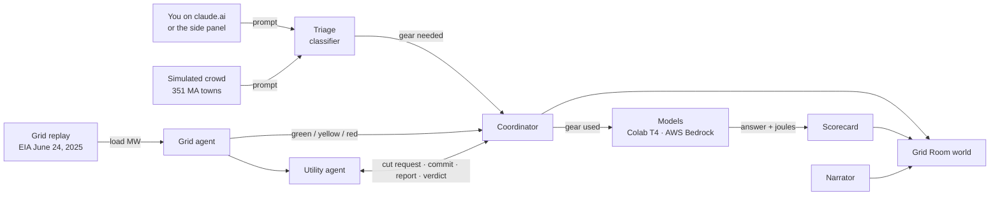

# Tokenwise

**Energy-smart AI: right-sizes the model for every prompt, and shifts down when the power grid peaks.**

Hackachusetts 2026 · Track 3, Climate Tech · *(the codebase still uses its working name, **Downshift**)*

---

## The problem

AI runs every prompt at full power, at any hour, no matter how simple the question or how strained the grid.

| | |
| --- | --- |
| **~415 TWh** | Electricity used by data centers worldwide in 2024, about 1.5% of all electricity. Projected to reach **~945 TWh by 2030**, more than double. [1] |
| **4.4% → up to 12%** | US data centers' share of national electricity in 2023, and the projected share by 2028. [2] |
| **0.24 Wh** | Energy of one median text prompt to a frontier assistant. Small per prompt, but it is paid billions of times a day. [3] |
| **25,898 MW** | New England demand at 7 PM on June 24, 2025 (EIA hourly data, the day replayed in our demo), during a heat wave that pushed the region's grid to its limits. [4] |
| **5 tiers** | A "what's 15% of 80" doesn't need the same model as "design a distributed database". Today, both usually get the big one. |

AI is one of the fastest-growing loads on the grid, and it has **no dimmer**: nothing lowers it when the grid is stressed.

## What Tokenwise does

Tokenwise gives AI a dimmer. It pulls three levers:

1. **Right-size every prompt.** A trained classifier gives each prompt one of five tiers (we draw them as pickaxes, Wooden to Netherite), so easy prompts run on small, efficient models and only hard ones reach the big ones.
2. **Follow the grid.** Five agents watch real grid load. When the grid goes red, the utility asks for a cut, and the coordinator delivers it by shifting traffic down a tier and deferring batch work. It reports what it actually saved, and the utility accepts or pushes back.
3. **Leaner prompts.** *In progress:* trimming the prompt and nudging toward shorter answers, so fewer tokens are spent per question.

Then it **proves it live**: a voxel diorama of Holyoke, MA, where every prompt flies from a home to the data center, the sky turns red when the grid peaks, and a scorecard compares joules per answer with and without Tokenwise.

## How it works



Every component talks only through an **event bus** (`prompt.received → triage.decided → route.decided → answer.completed`, plus grid, utility and coordinator events). That's how two people built it in parallel and the agents still negotiate live.

### The five agents

| Agent | Kind | What it does |
| --- | --- | --- |
| **Triage** | Trained classifier (logistic regression, with a rules fallback) | Gives each prompt a gear from 1 to 5 |
| **Grid** | Rules | Turns grid load into a level: green ≤ 20,000 MW, yellow ≤ 23,500 MW, red above |
| **Utility** | Deterministic negotiator | Red for two samples in a row: asks for a 25% cut for 120 minutes. Shortfall over 3 points: escalates once |
| **Coordinator** | Policy + prediction | Predicts the cut it can deliver, shifts gears down, defers batch work, protects "best answer" prompts, and reports achieved vs baseline joules |
| **Narrator** | Templates + LLM with a number guard | One plain-English line every 8 s. Any number not in the events is replaced by a template |

### The five gears

| Tier | Gear | For | Local model (Colab T4) | Cloud model (AWS Bedrock) |
| --- | --- | --- | --- | --- |
| 🪵 Wooden | 1 · Quick | a fact, a sum, a one-line rewrite | `qwen2.5:0.5b` | Amazon Nova Micro |
| 🪨 Stone | 2 · Light | short explanation, summarize, extract | `llama3.2:1b` | Amazon Nova Lite |
| ⚙️ Iron | 3 · Standard | multi-paragraph writing, simple code | `llama3.2:3b` | Claude Haiku 4.5 |
| 💎 Diamond | 4 · Heavy | multi-step reasoning, real code | `llama3.1:8b` | Amazon Nova Pro |
| 🟪 Netherite | 5 · Max | hard math, architecture, long writing | — | Claude Sonnet 4.6 |

## What you can see in the demo

**The Grid Room world** (`gridroom/`, http://localhost:5173): a block-style diorama of Holyoke with Mt Tom, the Connecticut River, the Holyoke Dam's hydro station, downtown homes and an illustrative data center.

- **Orbs:** each prompt flies home → data center. **Amber** means it ran at the gear it needed; **green** means it was shifted down.
- **The data center's beacon** and the **sky** follow the grid level, and the camera pushes in on red.
- **Left panel:** grid load and curve, data-center watts, prompts routed and shifted down, energy saved, and the scorecard.
- **Right panel:** live decisions, as the utility and coordinator negotiate.
- **Simulation / Live:** Simulation shows the crowd. Live shows only real prompts, which fly from the blue **YOU** house.
- **Keys:** `R` replay · `1–3` speed · `A` grid alert · `X` reset · `S`/`L` mode · drag to orbit. The classic state map is at `?view=classic`.

**The browser extension** (`extension/`):

- **claude.ai:** every prompt you send is classified and routed by the real agents, and shows up in the world as your orb.
- **Side panel:** a pickaxe hotbar to choose a tier (or Auto), a grid status beacon, the narrator, and "Ask me anything", which answers on the chosen tier and shows time, energy and Wh saved.

## Results so far

| Metric | Result |
| --- | --- |
| Triage, within-one-gear accuracy | **88.7%** (5-fold CV, n = 1,794; target 85%) |
| Triage, exact-gear accuracy | 59.2% |
| Grid replay | The real June 24, 2025 curve goes green → yellow (11:48 AM) → red (3:47 PM) → green |
| Crowd load | ~200 prompts per replay hour, every one truly routed through Triage and Coordinator |
| Energy | Measured on a Colab T4 through `nvidia-smi`, falling back to labelled estimates |

## What's real and what's simulated

We label this on screen, and we'll say it on stage.

| Real | Simulated |
| --- | --- |
| Triage classifier, Coordinator and Utility negotiation, routing | The crowd of users (held-out prompts replayed from MA towns) |
| Your claude.ai and side-panel prompts | The grid day: a **replay** of real EIA data, not today's grid |
| Model answers (Colab T4 / Bedrock) and the GPU wattmeter | The data center's location and size (labelled "illustrative") |

A single prompt is small (about 0.24 Wh [3]); the megawatts come from data centers and companies running this engine across millions of requests, not from one browser extension.

## Quick start

**Requirements:** Python 3.10+, Node 18+, Chrome. Optional: a Google Colab T4 for real models and watts, and AWS Bedrock access for Gear 5.

```powershell
# 1. Engine
python -m venv .venv; .\.venv\Scripts\Activate.ps1
pip install -r requirements.txt
copy .env.example .env        # add keys; see below
uvicorn engine.app:app --port 8000

# 2. Grid Room
cd gridroom; npm install; npm run dev     # http://localhost:5173

# 3. Start the June 24 replay (or press R in the Grid Room)
Invoke-RestMethod -Method Post -Uri http://localhost:8000/v1/demo/replay `
  -ContentType 'application/json' -Body '{"date":"2025-06-24","speed":480}'
```

4. **Extension:** in `chrome://extensions`, turn on Developer mode, click **Load unpacked** and choose `extension/`.
5. **Colab (optional):** open `colab/sip_colab.ipynb`, set the runtime to T4, Run all, and paste the two printed URLs into `.env` as `OLLAMA_URL` and `POWER_URL`. They change on every restart.

**`.env` keys:** `AWS_BEARER_TOKEN_BEDROCK`, `AWS_REGION`, `OLLAMA_URL`, `POWER_URL`, `POWER_SOURCE` (`estimate` | `nvidia-smi` | `cloud`), `EIA_API_KEY`. With no keys at all, set `$env:DOWNSHIFT_MOCK=1` and the engine replays a recorded scenario.

### API at a glance

| Endpoint | What it does |
| --- | --- |
| `POST /v1/triage` | `{prompt}` → gear and confidence. With `observe: true`, it also routes the prompt through the agents (used for claude.ai) |
| `POST /v1/answer` | `{prompt, mode: "auto" or "gear N", protected?}` → answer, gear used, latency and joules |
| `GET /v1/grid` | Latest grid state |
| `POST /v1/demo/replay` | `{date, speed}`: replays June 24, 2025 (`speed` = replay seconds per real second) |
| `POST /v1/demo/alert` | `{level}`: manual grid alert |
| `WS /v1/stream` | Every bus event, live |

Full contracts: [`contracts/api.md`](contracts/api.md), [`contracts/events.ts`](contracts/events.ts), [`contracts/gears.json`](contracts/gears.json).

## Repo layout

```
contracts/   Frozen contracts: gears.json, events.py/.ts, api.md, fixtures/
engine/      FastAPI engine: event bus, agents (triage, grid, utility, coordinator, narrator),
             llm (Ollama + Bedrock), power meter, replay, metrics, answer API
training/    Labelled prompts, classifier training, quality eval
sim/         Crowd simulator (351 Massachusetts towns)
data/grid/   EIA June 24, 2025 hourly demand cache
extension/   Chrome extension: claude.ai content script + side panel
gridroom/    Grid Room: voxel world (default), classic map + HUD (?view=classic)
colab/       GPU host notebook: Ollama, nvidia-smi power endpoint, tunnels
```

## Tests

```powershell
python -m pytest engine sim                                   # engine + crowd
node --test extension/src/panel/*.test.mjs                    # side panel
npx --yes tsx@4.19.2 --test gridroom/src/scene/logic.test.ts gridroom/src/scene/demo.test.ts gridroom/src/scene/world/world.test.ts
```

## Team

Built in one day by two people working in parallel through frozen contracts:

- **Aru** (demand side): triage classifier, grid and coordinator agents, answer API, power meter, Colab host, metrics, the claude.ai content script, the classic HUD.
- **Junaid** (supply side): grid data and replay, Bedrock client, training data, utility and narrator agents, crowd simulator, the Grid Room world, the side panel.

## Contributing

One PRD row = one branch = one PR, branched from the latest `main`. Edit only the folders you own. `contracts/`, `engine/app.py` and `engine/bus.py` change only through a joint `contract:` PR. Enable the commit hook once per laptop with `git config core.hooksPath .githooks`. Planning docs: [`PLAN.md`](PLAN.md), [`docs/`](docs/).

## Roadmap

- Leaner prompts: trimming prompts and nudging toward shorter answers
- Carbon view: CO₂ and Wh saved per user on claude.ai (in review)
- Live grid feed for "now" alongside the replay
- An OpenAI-compatible endpoint, so a company can switch to Tokenwise by changing one line

## Sources

1. International Energy Agency, *Energy and AI* (April 2025): data center electricity use in 2024 and the 2030 projection.
2. Lawrence Berkeley National Laboratory, *2024 United States Data Center Energy Usage Report* (December 2024).
3. Google, *Measuring the environmental impact of AI inference* (August 2025): median Gemini Apps text prompt.
4. U.S. Energy Information Administration, hourly electricity demand for ISO New England, June 24, 2025 (cached in [`data/grid/june24.json`](data/grid/june24.json)).
